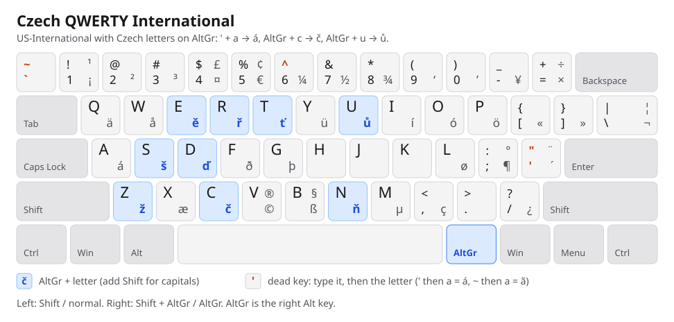
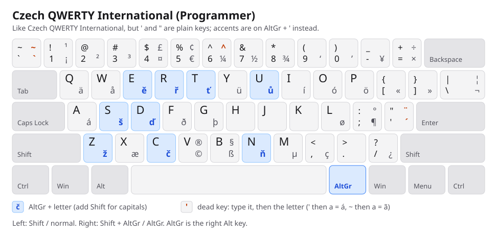

# Czech QWERTY International

A US QWERTY keyboard layout with intuitive Czech accents, designed for multilingual typing and programming.



Every accented letter is typed from the letter it is based on. You never need to remember that ů is on `;` or that č is on `4`:

| You type | You get | |
|---|---|---|
| `'` then `a` `e` `i` `o` `u` `y` | á é í ó ú ý | čárka, as on US-International (and phones) |
| `AltGr` + `c` `d` `e` `n` `r` `s` `t` `z` | č ď ě ň ř š ť ž | háček |
| `AltGr` + `u` | ů | kroužek |
| add `Shift` | Á Č Ď Ě Ň Ř Š Ť Ž Ů … | capitals; Caps Lock works too |

`AltGr` is the right `Alt` key. Everything else is plain US QWERTY, so programming symbols stay where you expect them, and you can write English, Czech and other languages without switching keyboards.

It builds on Windows' **US-International** layout, so its other accents still work: `~` then `a` → ã, `^` then `e` → ê, `` ` `` then `a` → à, `"` then `u` → ü, `'` then `c` → ç. Every character US-International can type is still there; a few AltGr ones moved to make room ([see below](#good-to-know)).

## Two variants

**Czech QWERTY International**: `'` and `"` are dead keys, as on US-International. `'` followed by a consonant types normally (`don't`), but `'` followed by a vowel always makes an accent, so for a plain apostrophe before a vowel (`'apple'`) press `'` then `Space` first.

**Czech QWERTY International (Programmer)**: `'` `"` `` ` `` `~` `^` type themselves immediately, as on plain US QWERTY, so code like `'a'` never turns into `á'`. The accents move to AltGr: `AltGr` + `'` then `a` → á.



Install both and switch with `Win` + `Space`. The Czech letters are on AltGr in both.

## Install

Download the zip for your system from [Releases](https://github.com/gustavostz/czech-qwerty-international/releases).

### Windows 10 and 11

1. Unzip `czech-qwerty-international-…-windows.zip`.
2. Double-click `install.cmd` and accept the administrator prompt.
3. Press `Win` + `Space` to switch to **Czech QWERTY International**.

The installer copies the layout DLLs to the Windows folder, registers both layouts, and adds the standard one to your keyboards (to English (United States) if you have it). To add the Programmer variant too, run `powershell -ExecutionPolicy Bypass -File install.ps1 -Enable Both`, or add it in **Settings › Time & language › Language & region**. Apps that were already open may need a restart.

To remove it, double-click `uninstall.cmd`.

It is a native Windows layout, like the ones Windows ships with: no background app, and it works in every program. Builds are included for x64, 32-bit and ARM64 Windows.

### macOS

1. Unzip `czech-qwerty-international-…-macos.zip` and copy the `.keylayout` files to `~/Library/Keyboard Layouts/`.
2. Log out and back in.
3. In **System Settings › Keyboard › Text Input › Edit › +**, choose **Others › Czech QWERTY International**.

`Option` plays the role of AltGr.

### Linux

Copy the XKB symbols file and select the layout `czqi` (variant `programmer` for the Programmer variant):

```sh
mkdir -p ~/.config/xkb/symbols
cp symbols/czqi ~/.config/xkb/symbols/

# GNOME (Wayland and X11)
gsettings set org.gnome.desktop.input-sources sources "[('xkb', 'czqi'), ('xkb', 'czqi+programmer')]"

# Any X11 session
setxkbmap -I ~/.config/xkb -layout czqi -print | xkbcomp -I"$HOME/.config/xkb" - "$DISPLAY"
```

For a system-wide install, copy `czqi` to `/usr/share/X11/xkb/symbols/` instead. Dead keys use your system's Compose rules, where `'` then `c` gives ć rather than ç.

## Good to know

- **AltGr is Ctrl + Alt on Windows.** An app with its own Ctrl + Alt + letter shortcut (some IDEs and tray utilities) can catch `AltGr` + that letter before it is typed. This affects every AltGr layout, including Windows' Polish and Czech ones. If it happens, remove or remap that shortcut in the app.
- **ď and ť are on AltGr, not on `'`.** `'` then `d` or `t` stays an apostrophe and the letter, so English contractions like *don't* and *I'd* type normally.
- **US-International characters that moved.** The Czech letters took over a few AltGr keys. Their old characters are still there, next door: ð Ð on `F`, þ Þ on `G`, æ Æ on `X`, © ® on `V`, ß § on `B`, ¢ on `Shift` + `AltGr` + `5`. é, ú and ñ are typed with `'` + `e`, `'` + `u` and `~` + `n`.
- **Testing status.** The tests type every key of the compiled Windows layout and compare it with Windows' own US-International DLL, and every CI build also checks it against Microsoft Keyboard Layout Creator's compiler. The ARM64 build, the macOS layout and the Linux layout are generated from the same definition and checked for structure, but have not yet been tried on real machines. Reports are welcome.

## Build from source

Requires [Bun](https://bun.sh). Building the Windows DLLs also needs Visual Studio with the C++ build tools (and the ARM64 tools for ARM64).

```sh
bun install
bun run generate   # regenerate platforms/ and docs/ from src/layout
bun run build      # generate, then compile the Windows DLLs into build/windows
bun test           # checks the layout, the generated files and (after a build) the DLLs
```

The whole layout is defined once in [`src/layout`](src/layout): [`us-international.ts`](src/layout/us-international.ts) is Windows' US-International, and [`index.ts`](src/layout/index.ts) adds the Czech letters and defines both variants. Everything else is generated from it:

| Path | What |
|---|---|
| `build/windows/` | Windows DLLs and installer, compiled directly with MSVC (`scripts/build-windows.ts`) |
| `platforms/windows/*.klc` | sources for [Microsoft Keyboard Layout Creator](https://www.microsoft.com/download/details.aspx?id=102134), to customize the layout |
| `platforms/macos/*.keylayout` | macOS layouts |
| `platforms/linux/symbols/czqi` | Linux XKB layout with both variants |
| `docs/*.svg` | the diagrams above |

To publish a release, set `version` in `package.json`, commit, and push a matching tag (`v0.1.0`); CI builds, tests and attaches the packages.

## License

[MIT](LICENSE)
